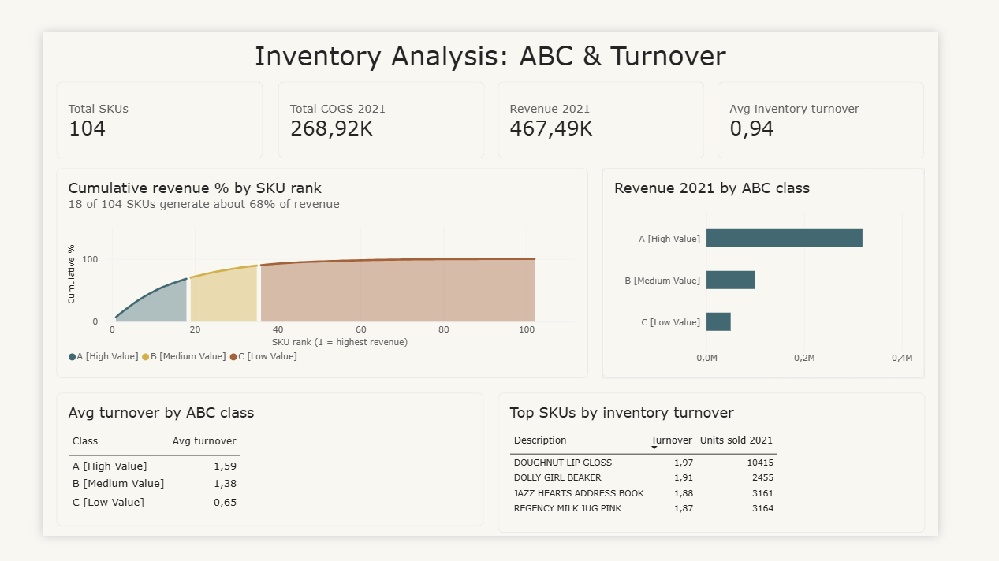
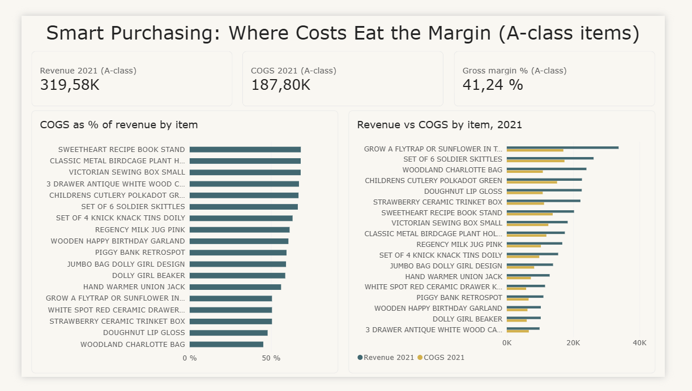
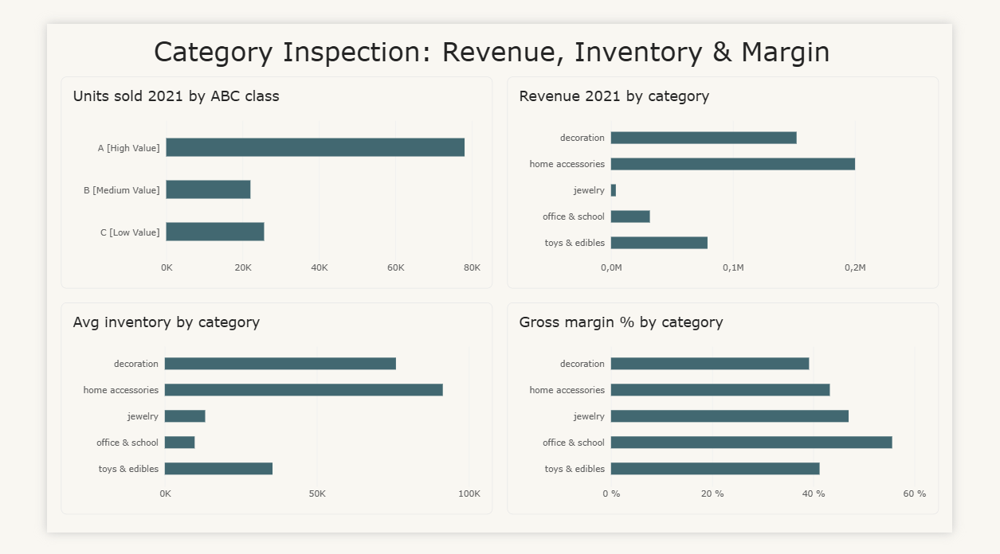

# Inventory Analysis: ABC Classification & Turnover (Power BI)

Which SKUs drive revenue, which tie up cash, and where do costs eat the margin?

Built on the dataset from DataCamp's "Inventory Analysis in Power BI" case study.
I rebuilt and extended the dashboards myself.

## Dashboards

## Key findings
- 18 of 104 SKUs (17%) generate about 68% of 2021 revenue (ABC class A).
- Turnover falls by class: A = 1.59, B = 1.38, C = 0.65. Class C ties up cash.
- Overall gross margin is about 42.5% (COGS 268.92K vs revenue 467.49K).
  Class A alone: 41.24%.
- Office & school has the highest category margin but a small revenue base.

## Method
- Model: Stock, Costs, ABC, Turnover, categories tables, linked by SKU.
- Calculated column: `TotalCOGS2021 = Stock[Quantity_2021] * RELATED(Costs[COGS])`
- Measure: `Gross margin % = DIVIDE(SUM(Stock[Revenue_2021]) - SUM(Stock[TotalCOGS2021]), SUM(Stock[Revenue_2021]))`
- Pareto chart: cumulative revenue % by SKU rank, split by ABC class.

## Limits and what I'd check next
- Margin uses COGS only. Advertising, distribution and labor costs are not included.
- Turnover is averaged per class. Summing ratios is meaningless.
- ABC thresholds come from the case study. Different cut-offs would change class sizes.
- 2022 sales look partial. I did not use them.

## Tools
Power BI Desktop, DAX
